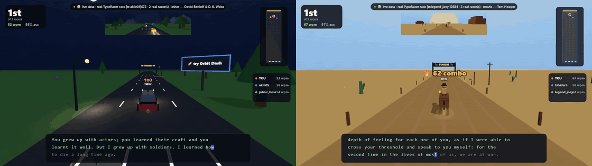
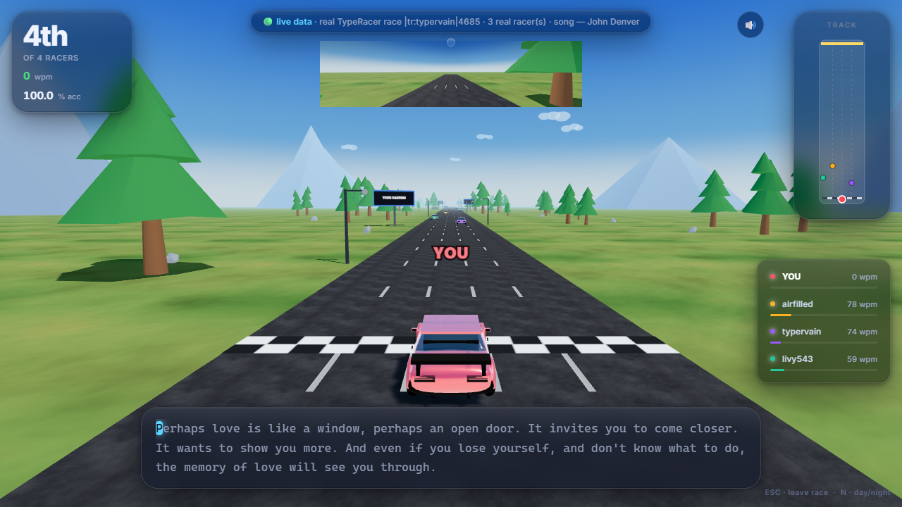
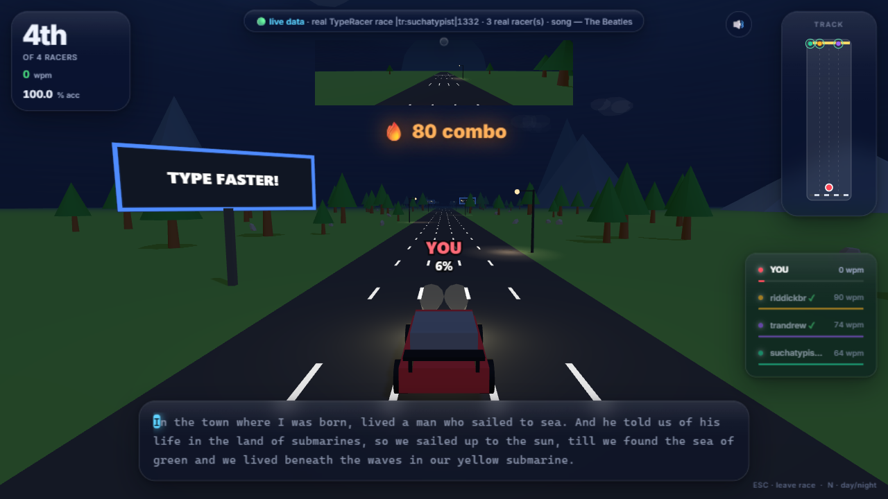
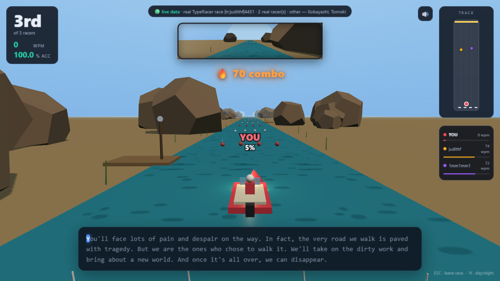
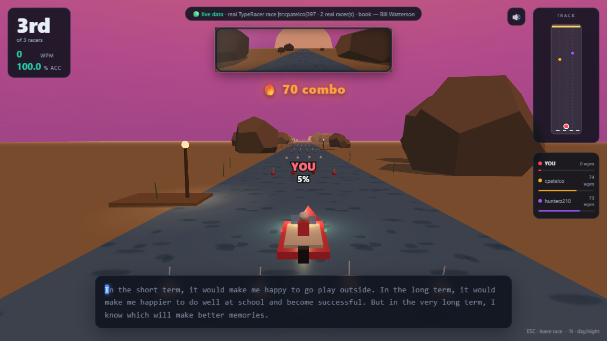
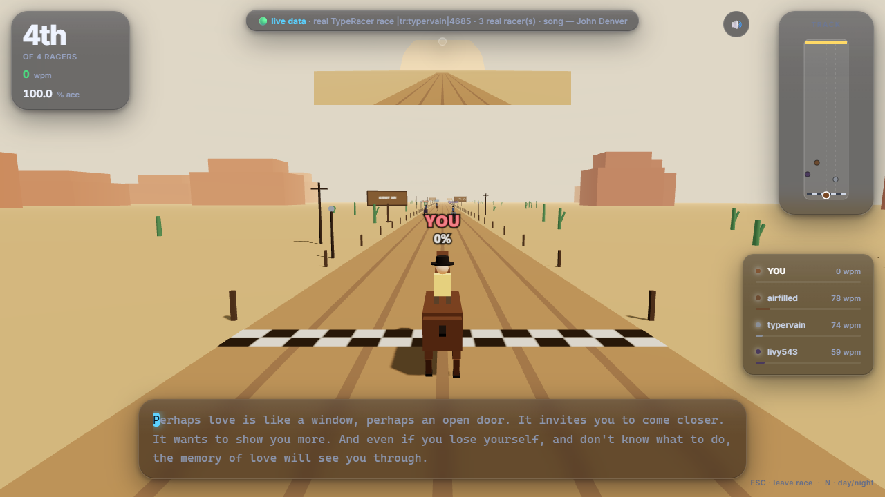
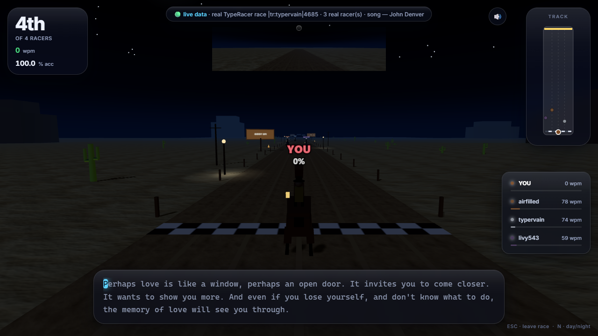
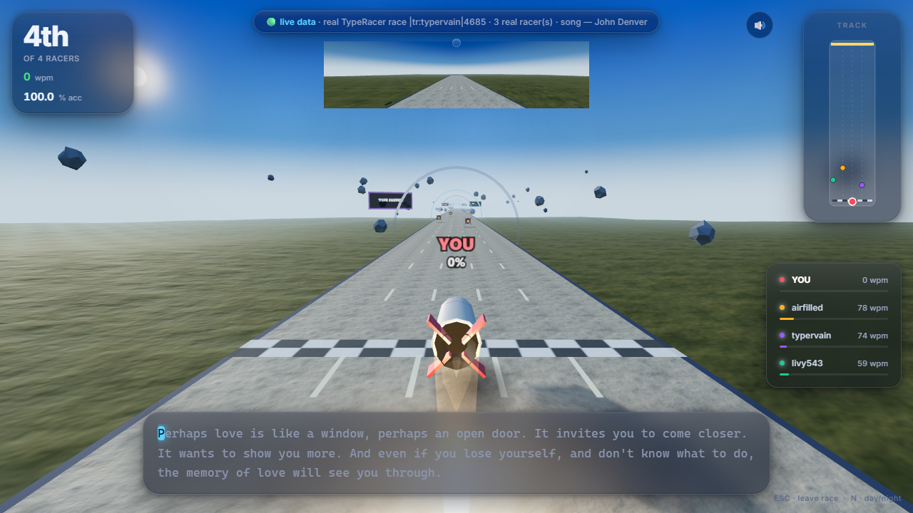
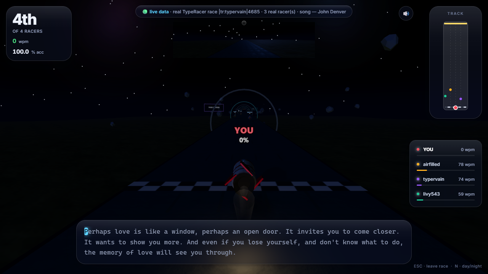

<div align="center">

# 🏁 TypeRacer 3D

**Race real TypeRacer races in a 3D world — cars, boats, horses and rockets.**

Every race is a *real historical TypeRacer race*: the real quote, the real source,
the real opponents — and bots that **replay those humans' exact keystroke timing**.

[](#-run)
[](#-run)
[](#-play-online-github-pages)
[](LICENSE)

**4 themes · Day / Sunset / Night · realistic & arcade typing modes**



*Real races, side by side: 🏎 night street | 🐎 wild west — bots replaying real
humans' keystroke timing, typed at a human ~60 WPM with hesitations and
backspace-fixed typos (full clips: `media/gameplay-car.mp4`, `media/gameplay-horse.mp4`)*

</div>

---

## ✨ What is this?

[TypeRacer](https://play.typeracer.com/) is the classic "type the quote, win the race" game.
**TypeRacer 3D** turns it into a 3D racing game — without ever touching live multiplayer.

- 🟢 **Real data, read-only.** Races come from TypeRacer's public stats site
  (`data.typeracer.com`): real quote, real book/movie/song attribution, real opponents.
- ⏱ **Bots replay real humans.** TypeRacer result pages contain the winner's typing log —
  the exact millisecond timing of every keystroke. Your opponents *are* those humans,
  replayed keystroke-for-keystroke.
- 🎮 **Everything reacts to your typing.** Your vehicle's speed follows your rolling WPM.
  Combo streaks ignite exhaust flames. Overtakes are announced. Errors shake the camera.
- 🏎️🚤🐎🚀 **Four themes**, all live: *Street Race*, *River Rapids*, *Wild West Ride*, *Orbit Dash*.
- 🌗 **Day / Sunset / Night** in every theme — switchable live with **N**.
- 🪞 **Rearview mirror** + **top-down minimap** of the whole track.
- ⌨️ **Two typing modes:** *Realistic* (wrong chars stick — fix them with **Backspace**,
  TypeRacer-style) or *Arcade* (wrong keys don't stick).
- 📣 **Share & challenge.** One click on the results screen copies your result plus a
  **challenge link** — whoever opens it replays the *exact same race* against the same
  real opponents, in the same theme (`?race=…&theme=…&tod=…`).
- 📲 **Installable (PWA) & offline.** Manifest + service worker included — install it
  from Chrome/Edge and it runs with zero network.
- 🧪 **Zero dependencies.** One vendored Three.js file. No build step. No npm install.

## 🚀 Run

**Windows (easiest):** double-click **`Start TypeRacer 3D.bat`** — starts the server and opens your browser.

**macOS / Linux:**

```bash
./run.sh          # or simply: node server.js
# → open http://localhost:8787
```

Requires Node 18+. No install step — there are no dependencies.

## 🌐 Play online (GitHub Pages)

Without a server the game auto-switches to **demo mode**: bundled quotes and
synthetic opponents (clearly labeled `🟠 demo race`). Deploy it yourself:

1. Push this repo to GitHub (Settings → Pages → Deploy from branch → `main` /root),
   or just keep the included workflow at `.github/workflows/pages.yml` which
   publishes `public/` automatically.
2. `https://<you>.github.io/<repo>/` — playable, installable, shareable.

Run `node server.js` locally any time to race **real** TypeRacer data instead.

## 🎥 Screenshots

| | |
|---|---|
|  |  |
| *Street Race — day* | *Street Race — night* |
|  |  |
| *River Rapids — day* | *River Rapids — sunset* |
|  |  |
| *Wild West Ride — day* | *Wild West Ride — night* |
|  |  |
| *Orbit Dash — day* | *Orbit Dash — night* |

## 🧠 Where the "real data" comes from

All **read-only public pages** from `data.typeracer.com` (TypeRacer's own stats site):

| Endpoint used | Gives us |
|---|---|
| `pit/race_history?user=X` | recent real races of real users (ids + speeds) |
| `pit/result?id=\|tr:USER\|N` | the full quote text, its source, and **all racers of that race** with WPM/accuracy |
| typing logs (`TLv1…`) inside result pages | the **exact keystroke timing** of each real racer — bots replay it |
| `pit/profile?user=X` | your real avg / best / races count (optional, in the menu) |

Races are cached in `data/cache/`, and the username pool (`data/pool.json`)
self-grows from real opponents seen in races.

> ### ⚖️ Honesty & fairness note
> You are **not** secretly entering live multiplayer races — that would require
> automating input into TypeRacer (ban risk, and against their ToS). Instead you
> **replay real completed races against that race's real racers**. Read-only,
> polite (disk-cached), and every race's attribution is shown in the HUD.

## 🎮 Gameplay

- Type the quote. Wrong chars count as errors — camera shake, speed loss.
- **Realistic mode:** wrong chars stick in red; fix them with **Backspace**.
- Your vehicle's velocity follows your **rolling WPM** — FOV, speed streaks and the
  engine hum react to it.
- Bots are the race's real racers. Pace: Chill ≈45 · Normal ≈70 · Hard ≈95 ·
  **Match my real average** (enter your TypeRacer username) · **Real speeds**.
- If your username matches one of the fetched race's racers, **you take their slot**.
- **Combo:** streaks of correct chars ignite exhaust flames / spray / dust / afterburners;
  milestones (25/50/100/200/300/500) trigger fanfares. Overtakes announce themselves.
- **ESC** leaves a race · window blur pauses · **N** cycles Day → Sunset → Night live.
- Personal best WPM is stored locally and celebrated on the results screen.

## 🗂 Project layout

```
server.js               zero-dependency Node server: static + data proxies + cache
Start TypeRacer 3D.bat  double-click launcher (Windows)
run.sh                  bash launcher
public/
  index.html            menu / HUD / results shells (+ social OG tags)
  style.css
  og.jpg                social link-card preview (1200×630)
  favicon.svg           checkered-flag tab icon
  manifest.webmanifest  PWA manifest (installable)
  sw.js                 service worker (offline caching)
  icons/                PWA app icons (192 / 512 / 512-maskable)
  vendor/three.module.js  Three.js r160 (vendored, works offline)
  js/
    main.js             phase machine, settings, render loop
    race.js             racers, difficulty scaling, bot replay, standings
    typing.js           char validator (arcade + backspace modes) + rolling WPM
    world.js            renderer, chase cam, rearview mirror, effects
    sound.js            tiny WebAudio engine hum + blips
    hud.js              HUD, minimap, combo, toasts, results
    api.js              data access (local server, demo fallback)
    demo-data.js        bundled offline races for static hosting
    themes/
      index.js          theme registry (car / boat / horse / rocket — all live)
      shared.js         labels, textures, sky-follow, vehicle motion helpers
      car.js            🏎 street race
      boat.js           🚤 canyon river
      horse.js          🐎 wild west trail
      rocket.js         🚀 low-orbit drag strip
media/
  gameplay-split.gif    README teaser: car (night) | horse (day) side by side
  gameplay-car.mp4      full car race clip (local, for social uploads)
  gameplay-horse.mp4    full horse race clip (local, for social uploads)
```

## ➕ Adding a new theme

Add an entry to `public/js/themes/index.js` with a
`create(world, { racers, seed, timeOfDay })` factory returning
`{ group, vehicles, update(dt, racersState), finishZ, setTimeOfDay }`.
Typing, bots, HUD, minimap, mirror, camera and day/night are all theme-agnostic.

## ❓ FAQ

**Is this affiliated with TypeRacer?**
No. TypeRacer is a trademark of its respective owners. This is an independent,
read-only fan project; no live races are entered and nothing is submitted back.

**Does it play against real people live?**
No — that's the point. It replays *real completed races* against the real racers
of those races, with their genuine keystroke timing.

**Why do I need `node server.js` for real data?**
Browsers block cross-site requests to `data.typeracer.com`, so a tiny local proxy
fetches/caches them. No data leaves your machine except those public read-only
requests.

**Does it work offline?**
Yes. Three.js is vendored, and without the server the game runs in demo mode
with bundled quotes.

**Windows SmartScreen warns about the .bat file?**
It's a plain-text script — open it in Notepad to see: it runs `node server.js`
and opens your browser.

## 📄 License

MIT — see [LICENSE](LICENSE). Quotes shown in races belong to their respective
sources; game data © [TypeRacer](https://play.typeracer.com/).
